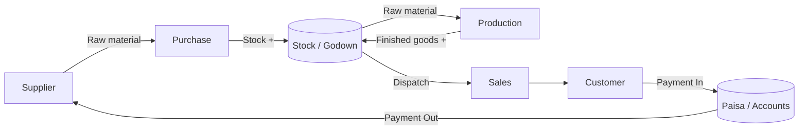
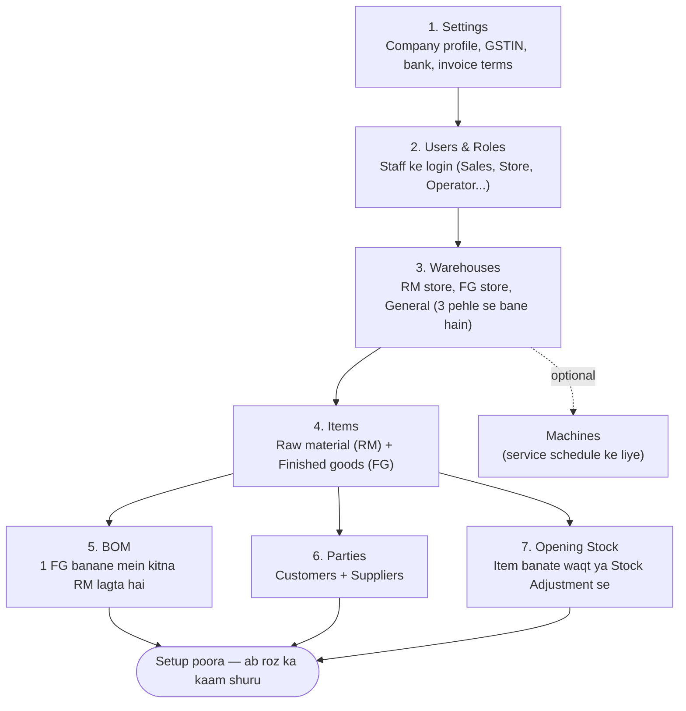
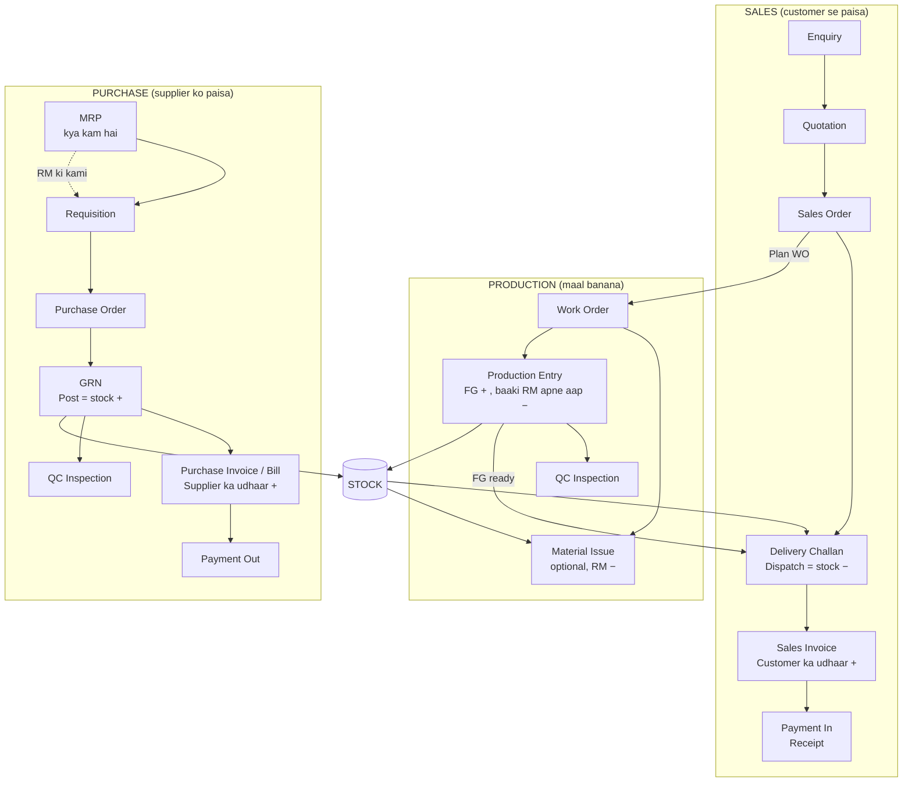
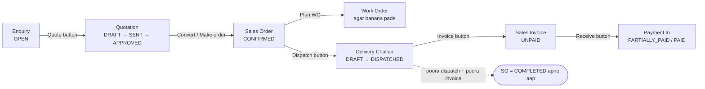
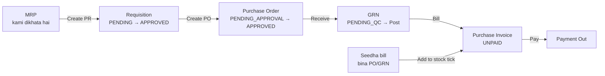
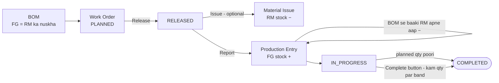
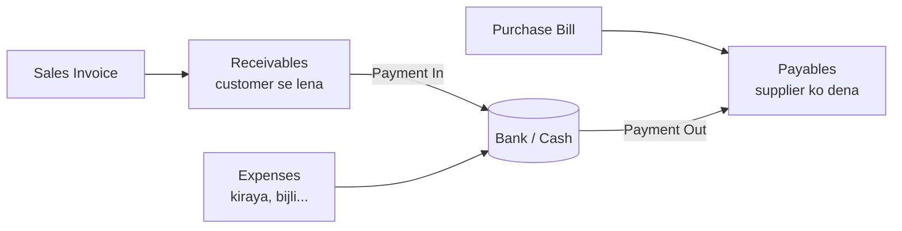
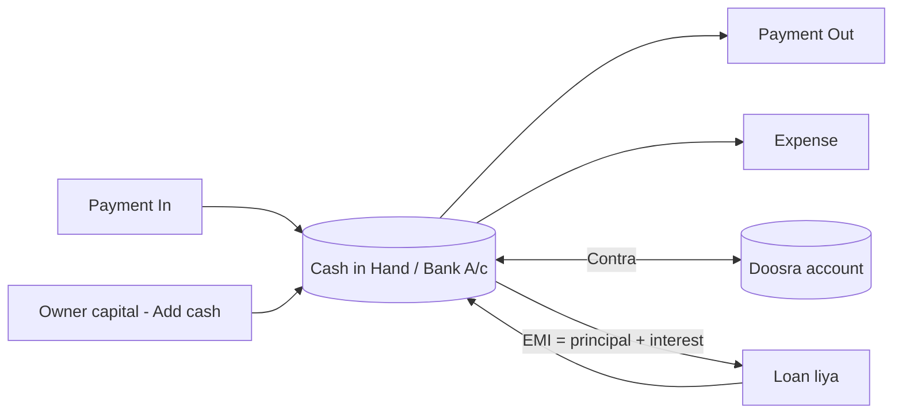
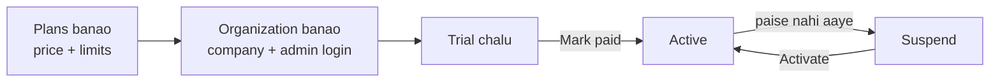

# ManuFlow ERP — Poora Flow Guide (Zero se shuru)

> Live: **https://www.menu.aetherdevsolutions.online**
> Ye guide un logon ke liye hai jinhe software ke baare mein kuch nahi pata. Upar se neeche padho — pehle **Setup**, phir roz ke **3 cycle** (Sales, Purchase, Production).
>
> Flowcharts dekhne ke liye: VS Code mein `Ctrl+Shift+V` (Markdown Preview). Agar diagram ki jagah code dikhe to extension **"Markdown Preview Mermaid Support"** install karo. GitHub par ye apne aap dikhte hain.

---

## 1. Ye software kya karta hai — ek line mein

Factory ka poora kaam ek jagah: **maal kharidna → stock rakhna → production karna → maal bechna → paisa lena/dena**, GST ke saath.

---

## 2. PEHLI BAAR SETUP — kya pehle add karna hai (isi order mein)

> Rule: **jo cheez doosri cheez mein use hoti hai, wo pehle banao.** Item ke bina BOM nahi banta, BOM ke bina production ka hisaab nahi hota, party ke bina bill nahi banta.

| # | Screen (sidebar mein) | Kya bharna hai | Kyun zaroori |
|---|---|---|---|
| 1 | **Admin → Settings** | Company naam, GSTIN, address, state code, bank details, invoice/quotation terms, **logo + signature**, round-off, **document number prefix** (jaise INV ki jagah SI) | Har bill/quotation par yahi print hota hai; GST (CGST/SGST ya IGST) state code se decide hota hai |
| 2 | **Masters → Users & Roles** | Har staff ka email, password (min 8), role | Role decide karta hai kaun kya dekh/kar sakta hai (neeche section 9) |
| 3 | **Masters → Warehouses** | RM / FG / General store pehle se bane hain — zaroorat ho to aur | Stock store-wise rehta hai |
| 4 | **Masters → Items** | Naam, type (Raw / Finished / Semi / Consumable), UOM, HSN, GST %, rate, reorder level | Har document mein item chahiye. Code khaali chhodo to apne aap banega (RM-001, FG-001…) |
| 5 | **Masters → BOM** | Finished item chuno + uske raw materials aur qty | Production entry par raw material **apne aap** stock se katta hai |
| 6 | **Masters → Parties** | Customer / Supplier / **Both**, **GST type** (Regular / Composition / Unregistered…), shipping address — GSTIN dalo to PAN + state apne aap | Bills, orders, payments party par bante hain |
| 7 | Opening stock | Item banate waqt "Opening qty + store", ya **Inventory → Transfers & Adjustments → Adjustment** | Pehle din ka maal system mein aa jaaye |

---

## 3. BADA CHITRA — teeno cycle kaise jude hain

---

## 4. SALES CYCLE — step by step

| Step | Screen | Aap kya karte ho | System apne aap kya karta hai |
|---|---|---|---|
| 1 | Sales → Enquiries & Quotes → **Enquiries** | Customer ne kya poocha — items, qty | Kuch nahi (sirf record) |
| 2 | **Quotations** (Enquiry row par **Quote**) | Rate, GST, terms bharo → Send → Approve | Enquiry ke items apne aap aa jaate hain; total + GST calculate |
| 3 | **Sales Orders** (Quotation par **Convert**) | Customer PO no, delivery date, ship-to | Quotation ki terms copy hoti hain |
| 4 | Maal stock mein nahi hai? SO row par **Plan WO** | — | Work Order banta hai (Production cycle dekho) |
| 5 | **Delivery Challans** (SO row par **Dispatch**) | Qty, vehicle, transporter, e-way bill, LR | **Dispatch** dabate hi FG stock **minus**. Stock kam ho to dispatch ruk jaata hai |
| 6 | **Sales Invoices** (Challan row par **Invoice**) | Check karo, save | Challan ke items + SO ke rate; GST split; customer ka **udhaar badhta hai** |
| 7 | **Payments** (Invoice/Outstanding par **Receive**) | Amount, mode (Cash/NEFT/UPI…), reference | Invoice PAID/PARTIALLY_PAID; zyada amount reject |
| 8 | — | — | Poora dispatch + poora invoice hote hi SO **COMPLETED**. SO row par **Close** se haath se bhi band kar sakte ho |
| ↩️ | **Sales Returns** (Invoice row par **Return**) | Kaunsa maal kitna wapas aaya, store, reason | **Credit Note** banta hai: stock **plus**, customer ka baaki utna **kam** (invoice par adjust). Zyada ho to "refund due" dikhata hai |

**Counter / seedhi bikri (Vyapar jaisa):** `Alt + S` → Sales Invoice → **Cash Sale (walk-in)** tick → items scan/chuno → *Received now* poora → Save → **Receipt** (2"/3" thermal) ya A4/A5 print.

**Invoice par aur kya hai:** bill par discount (₹), freight aur packing (GST ke saath), round-off (Settings se on/off), "Received now" (bill ke saath hi payment), party ka **pichla rate apne aap**, ship-to address party se.

---

## 5. PURCHASE CYCLE — step by step

| Step | Screen | Aap kya karte ho | System apne aap kya karta hai |
|---|---|---|---|
| 1 | Manufacturing → **MRP** | Kami wale items select → **Create PR** | Open orders + reorder level se kami nikalta hai |
| 2 | Purchase → **Requisitions** | Approve / Reject | — |
| 3 | **Purchase Orders** (Requisition par **Create PO**) | Supplier, rate, payment/delivery terms → Submit → Approve | Requisition ke items aa jaate hain |
| 4 | **GRN** (PO row par **Receive**) | Kitna aaya, supplier invoice no/date, vehicle | QC inspection apne aap banti hai. **Post** dabate hi RM stock **plus** |
| 5 | **Purchase Invoices** (GRN par **Bill**) | Supplier invoice no/date, due date | Supplier ka **udhaar badhta hai** (Payables) |
| 6 | **Payments** (Bill/Payables par **Pay**) | Amount, mode | Bill PAID |
| ⚡ | **Seedha bill** (bina PO/GRN — chhoti kharidi) | `Alt + P` → Purchase Invoice → items (naya item wahin "+ Add new item") → **"Add these items to stock"** tick → *Paid now* | Stock bill ke saath hi plus; paid amount se Payment Out bhi ban jaata hai. Bill cancel = stock wapas minus |
| ↩️ | **Purchase Returns** (Bill row par **Return**) | Kaunsa maal supplier ko wapas | **Debit Note**: stock **minus**, supplier ka baaki utna **kam** |

---

## 6. PRODUCTION CYCLE — step by step

| Step | Screen | Aap kya karte ho | System apne aap kya karta hai |
|---|---|---|---|
| 1 | Masters → **BOM** | Ek baar: FG + raw materials + qty | — |
| 2 | Manufacturing → Production → **Work Orders** (ya SO par **Plan WO**) | Item, qty (khaali = 1), store (khaali = FG store) | Item ka active BOM apne aap lagta hai |
| 3 | WO row par **Release** | — | Ab maal issue / production ho sakta hai |
| 4 | **Material Issues** (WO par **Issue**) — *optional* | Kitna RM floor par diya | RM stock **minus** |
| 5 | **Production Entries** (WO par **Report**) | Produced / rejected / scrap qty, operator (dropdown), downtime, work details | FG stock **plus**. BOM ke hisaab se jo RM abhi tak issue nahi hua wo **apne aap minus** (backflush). RM kam ho to entry ruk jaati hai |
| 6 | — | — | Planned qty poori → WO **COMPLETED**. Kam par band karna ho to **Complete** button |
| 7 | Quality → **QC Inspections** | Pass / Fail / Partial | Notification |

> **Material Issue zaroori nahi.** Seedha Production Entry karo to BOM ka poora raw material apne aap katega. Pehle Issue kiya hai to sirf bacha hua katega — double nahi.

---

## 7. STOCK — kab badhta hai, kab ghatta hai

| Kaam | Stock par asar | Kahan dikhega |
|---|---|---|
| Item banate waqt opening qty | **+** | Items → "In Stock" column |
| GRN **Post** | **+** RM | Inventory → Stock / Stock Ledger |
| Seedha Purchase bill ("Add to stock" ke saath) | **+** | — |
| Production Entry | **+** FG, **−** RM (BOM) | — |
| Material Issue | **−** RM | — |
| Delivery **Dispatch** | **−** FG | — |
| Stock Adjustment | **+ / −** (galti sudhaarna) | — |
| Stock Transfer | Ek store **−**, doosra **+** | — |
| Sales Return (Credit Note) | **+** | — |
| Purchase Return (Debit Note) | **−** | — |
| Purchase bill cancel (jo stock jod chuka tha) | **−** | — |

- Stock **kabhi minus mein nahi jaata** — kam ho to system kaam rok deta hai aur batata hai kitna kam hai.
- Items screen par: **hara** = theek, **peela "low"** = reorder level tak, **lal** = khatam. Mouse le jao to store-wise qty.

---

## 8. PAISA — kisko dena, kisse lena

- **Finance → Outstanding** — Receivables (lena) / Payables (dena), kitne din purana (ageing), WhatsApp reminder, statement print.
- **Parties** mein kisi party par click → **Party 360**: total bill, mila/diya, baaki, overdue, saare orders, production jobs, deliveries, invoices, payments, timeline — aur wahin se naya order/bill/payment.
- **Finance → GST Reports** — GSTR-1 summary, HSN-wise.
- **Finance → Reports Center** — customer-wise sale, supplier-wise kharid, stock value, profit.

---

## 8A. CASH & BANK (Finance → Cash & Bank)

| Kaam | Kahan | Kya hota hai |
|---|---|---|
| Bank account jodna | Cash & Bank → Accounts → **Add bank account** | Opening balance, IFSC, UPI; "Print on invoice" tick karo to bill par ye bank chhapta hai |
| Shuru ki poonji (capital) | Cash in Hand → **Add cash** (category Capital) | Cash badhta hai, Balance Sheet mein Capital |
| Cash bank mein jama / nikalna | **Contra** | Ek account − , doosra + |
| Loan | Loans → **Add loan** → har mahine **Pay EMI** (principal + interest alag) | Interest P&L mein kharcha, principal se loan kam |
| Har payment / expense / bill ka paisa | Form mein "Account" chuno | Usi account ka balance badalta hai |
| Post-dated cheque | Payment mode CHEQUE + aage ki date | "Pending" — Deposit → Clear (tab balance mein aata hai) ya Bounce (invoice wapas baaki) |
| Bank reconciliation | Account → **Statement** → "Cleared" tick | Bank passbook se milaan |

## 8B. REPORTS (Finance → Reports Center)
- **Financial:** Profit & Loss (COGS ke saath), Balance Sheet, Cash Flow, Trial Balance
- **Transactions:** Daybook (ek din ke saare kaam), All Transactions, Sale / Purchase reports
- **Inventory:** Stock valuation, Item detail (ek item ki poori aavak-jaavak), Low stock
- **GST (Finance → GST Reports):** GSTR-1 (+ JSON download), GSTR-2 (kharid register), GSTR-3B summary
- Har report mein date filter (Aaj / Is mahine / FY / Custom), Excel / CSV / Print-PDF
- Dashboard par upar: **You'll Receive · You'll Pay · Cash in Hand · Bank Balance**

## 8C. ITEM — advanced
- **Dusri unit:** 1 BOX = 24 PCS — bill mein BOX ya PCS chuno, stock PCS mein
- **MRP, "price includes GST", rack, Cess %**
- **Variants:** Items → row → *Variants* → Size / Colour → saare combination apne aap ban jaate hain
- **Batch & Expiry:** item par "Track batch & expiry" → GRN / bill par batch + expiry → becho to sabse pehle expire hone wala apne aap (FEFO) → Inventory → Stock → **Batches & Expiry** tab (laal = expired, peela = 30 din mein)
- **Serial / IMEI:** item par "Track serial" → aate waqt aur bechte waqt serial number → Stock → **Serial numbers** tab mein search

## 8D. SURAKSHA aur KAI FIRMS
- **Security PIN** (Settings → Security): on karne par save hue bill / payment / return ko cancel-delete-edit karne ke liye PIN maangta hai
- **Kai firm, ek login:** Tenant Admin upar company dropdown → **+ Create new firm** → firmon ke beech switch
- **Roz ka auto backup** server par (14 din tak); Restore: Settings → Data & Backup (.json ya .json.gz)
- **Bill share:** Sales Invoice row → Share → WhatsApp / link copy (bina login khulne wala bill page, kabhi bhi "Revoke")

## 9. ROLES — kaun kya dekh sakta hai

| Role | Kya milta hai |
|---|---|
| Tenant Admin / Management | Sab kuch |
| Sales Manager / Executive | Items, Customers, Enquiry → Invoice, (Manager: Payments, Reports) |
| Purchase Manager / Executive | Items, Suppliers, Requisition → Bill, (Manager: Payments, Reports) |
| Production / Plant Manager | BOM, Machines, Work Orders, Issues, Production, MRP, QC |
| Production Supervisor | Work Orders, Issues, Production, MRP, QC |
| Operator | Work Orders, Production entry (operator dropdown mein inka naam aata hai) |
| Store Manager / Operator | Stock, Ledger, Transfers, Adjustments, GRN, Deliveries |
| Quality Manager / QC Inspector | QC, GRN, Production |
| Accounts Manager / Accountant | Invoices, Bills, Payments, Expenses, Outstanding, GST, Reports |
| Dispatch Manager | Sales Orders, Deliveries, Stock |
| Viewer | Sirf Dashboard |

---

## 10. KEYBOARD SHORTCUTS (time bachao)

| Key | Kaam |
|---|---|
| `Alt + S` | Kahin se bhi **naya Sales Invoice** |
| `Alt + P` | Kahin se bhi **naya Purchase Bill** |
| `n` | Jis screen par ho uska **naya form** |
| `Ctrl + S` (ya `Ctrl + Enter`) | Khula form **save** |
| `Ctrl + K` ya `/` | Search (items, orders, invoices, parties) |
| `?` | Saare shortcuts |
| `g d` | Dashboard |
| `g x` | Parties |
| `g i` | Items |
| `g q` / `g o` / `g h` / `g n` | Quotations / Sales Orders / Deliveries / Sales Invoices |
| `g p` / `g g` / `g f` | Purchase Orders / GRN / Purchase Invoices |
| `g w` / `g m` | Work Orders / MRP |
| `g y` / `g k` | Payments / Outstanding |
| `[` `]` | Pichla / agla module |

Dashboard ke **Quick actions** se ek click mein naya Sales Order / Quotation / PO / Payment / Work Order.

---

## 11. ROZ KA ROUTINE (checklist)

**Subah**
1. Dashboard dekho — low stock, pending approvals, notifications (🔔).
2. **MRP** chalao → kami ho to Requisition → PO.

**Din mein**
3. Maal aaya → **GRN** → Post → **Bill**.
4. Production floor → **Production Entry** (operator, qty, downtime).
5. Order taiyaar → **Dispatch** → **Invoice**.
6. Paisa aaya/gaya → **Payments**.

**Shaam**
7. **Outstanding** → overdue customers ko WhatsApp reminder.
8. Mahine ke end mein → **GST Reports** + **Reports Center**.

---

## 12. AKSAR AANE WALE MESSAGES — matlab aur upaay

| Message | Matlab | Kya karo |
|---|---|---|
| "Insufficient stock…" | Utna maal store mein nahi | GRN post karo / Stock Adjustment / doosre store se Transfer |
| "Not enough raw material for this production…" | BOM ke hisaab se RM kam | Pehle GRN se RM lao, ya BOM ki qty check karo |
| "Item already exists: RM-001 …" | Same naam ka item pehle se hai | Wahi item use karo (spelling alag ho to bhi system pakad leta hai) |
| "Plan limit reached…" | Aapke plan ki users/items/stores ki limit poori | Platform admin se plan badhwao |
| "This document was just changed by someone else" | Kisi aur ne usi waqt badla | Page refresh karke dobara |
| "Your session has ended — sign in again" | Password/role badla ya 12 ghante ho gaye | Dobara login |

---

## 13. PLATFORM ADMIN (sirf aapke liye — software bechne wale)

`/platform-admin` par (aetherdevsolutions@gmail.com se login):

- **Organizations** — nayi factory (customer company) banao, admin password ek baar dikhta hai — copy karke bhejo.
- Har company par: Mark paid, +7 din trial, Suspend, Customize plan (limits), Reset password, **Login as** (unki screen dekho), Delete.
- **Plans** — Basic/Standard/Premium jaise plan, price aur limits (users, stores, items).
